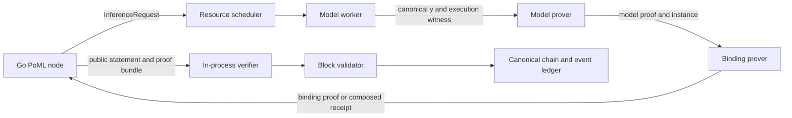

# PoML Stage 2 model and zero-knowledge proof plan

**Status:** study findings and implementation plan

**Date:** 26 November 2026

**Scope:** model execution, resource-aware scheduling, model proving, the
cryptographic binding relation, proof verification, and migration of the Stage
1 worker boundary

This document began as a design study. The repository now contains the first
Stage 2 execution slice behind the existing private worker protocol. It has a
dummy backend, a deterministic small diffusion backend, a Gemma adapter, and
the explicitly insecure random-proof compatibility profile. A production
model proof and the final binding proof are still future work. The Stage 1 Go
node remains the reference client and validates the temporary proof policy
through the same block path.

## Executive decision

The faithful Stage 2 target is the stochastic diffusion model described in the
paper. LLMs are also an explicit Stage 2 track, with Gemma 3 as the preferred
larger-model checkpoint and GPT-2 as the smallest compatibility benchmark. A
generic Hugging Face script can supply a useful adapter, but every consensus
profile must pin one exact model, tokenizer or sampler, quantization scheme,
randomness transcript, and output encoding. The model worker cannot choose
these details at runtime.

The recommended route has two proof layers.

1. Use EZKL for the first model proof because the paper's diffusion model can
   be reduced to a fixed ONNX graph and EZKL already turns ONNX computation
   into a Halo2-based proof workflow.
2. Use a small Rust zkVM guest for the PoML-specific binding relation. The guest
   verifies the encryption VRF, derives the prescribed encryption coins,
   checks the deterministic HPKE ciphertext, checks all public identifiers, and
   binds the model proof instance to the block statement.
3. Begin with a versioned proof bundle containing a model proof and a binding
   proof. Add recursive composition after the two independent verifiers and
   their statement-equality checks are stable. RISC Zero is the first
   composition candidate because its documented composition API lets a guest
   verify another receipt and resolve that assumption into a composed receipt.

This split keeps model-specific circuit work separate from cryptographic
protocol work. It also makes an early end-to-end experiment possible without
pretending that an Ed25519 signature over a statement is a model proof.

The protocol specification should still define one combined relation. The
separate workers are allowed to produce intermediate proof objects, but a
final proof-bearing block must require every component of that relation.

DeepProve should be used for the LLM track and as an alternative proving
backend when its supported arithmetic and output semantics fit a future
profile. The previous GPT-2 experiment exposed logits and performed sampling
outside the proof, which does not prove the private-output relation required
here. The Gemma profile must avoid the same shortcut.

## Evidence reviewed

The design below uses the following local sources.

- [Stage 1 node README](../README.md) describes the worker boundary, current
  cryptographic profile, process layout, and fixture certificate.
- [Stage 1 protocol boundary](protocol.md) records the frozen-prefix rule,
  winner-only-proof gate, ticket construction, fork choice, and hidden
  encryption transcript requirement.
- [Stage 1 implementation plan](../../docs/changes/2026-11-25-poml-stage-one-implementation-plan.md)
  records the Go interfaces and the Q1–Q7 decisions.
- [Paper model definition](../../PoML_paper_draft/4a_model.tex) defines the
  stochastic denoising model, the precomputed conditioning input, the initial
  noise, the per-step noise, and the complete output.
- [Paper protocol relation](../../PoML_paper_draft/4_protocols.tex) includes
  model execution, input commitment, encryption, and the encryption VRF in the
  PoML relation.
- [Paper security note](../../PoML_paper_draft/security_note.tex) gives the
  earlier stochastic-model motivation. The updated plan treats its
  anti-concentration result as supporting evidence for a fixed experiment,
  rather than as a proof that every cheaper algorithm is impossible.
- [Notion change plan](https://app.notion.com/p/41878999c4f38126858bd3cc6b002897)
  is the authority for the revised independent-attempt, winner-only-proof,
  hidden-encryption-transcript, and capacity-accounting rules. The detailed
  local snapshot used for this study is archived outside the repository under
  `/tmp/poml-qscope-tiae5sff/before.json`.

The main external implementation references are the [EZKL repository](https://github.com/zkonduit/ezkl),
the [DeepProve repository](https://github.com/Lagrange-Labs/deep-prove),
[RFC 9381](https://www.rfc-editor.org/rfc/rfc9381.html) for ECVRF, [RFC
9180](https://www.rfc-editor.org/rfc/rfc9180.html) for HPKE, and the [RISC Zero
proof composition documentation](https://dev.risczero.com/api/zkvm/composition).

## What the revised protocol requires

### One attempt

An attempt is an independent position-1 execution. It receives the frozen
parent and prefix, a query, an attempt identifier, the pinned model profile,
and its prescribed randomness transcript. It computes one complete output,
one encryption, and one candidate ticket.

The current Stage 1 client already performs the following host-side steps.

1. It derives the inference VRF input from the parent, prefix digest, model,
   query, miner, and attempt identifier.
2. It verifies or produces the public inference VRF result and expands that
   result into ordered inference randomness.
3. It invokes the inference worker.
4. It derives the encryption VRF result from the attempt context.
5. It creates the deterministic HPKE ciphertext and ticket hash.
6. It sends a private witness to the fixture certificate worker after a hit.

Stage 2 replaces the inference result and fixture certificate. The public
block format must retain enough data for every node to check the ticket and
enough proof data for every node to check the model and encryption relation.
Secret encryption coins, the encryption VRF proof, and the plaintext output
must remain inside the prover witness or a zero-knowledge proof.

### The winner proof

The winning proof must establish one conjunction for the exact attempt.

```text
M_model(input, R, model_digest, execution_profile) = y
H_output(y, output_commitment_nonce) = output_commitment
ECVRF.Verify(enc_vrf_pk, enc_vrf_input, enc_output, enc_proof) = true
HPKE.Seal(recipient_pk, y || qid || output_commitment_nonce, enc_output) = ciphertext
statement_fields = the block's parent, prefix, qid, attempt, model and keys
```

The host already verifies the public inference VRF and checks that its output
expands to the supplied inference randomness. Stage 2 should keep that cheap
public check. The binding proof must still bind the same attempt input and
randomness to the model-proof instance, so a prover cannot attach a valid
model proof from one attempt to the ciphertext from another.

If the final paper statement requires both VRF verifications to be inside one
zero-knowledge relation, the binding guest must also verify the inference VRF
and its randomness expansion. The first implementation should measure that
variant separately. Keeping the public inference check outside the proof is a
safe optimization only when the public statement explicitly treats it as a
consensus check.

The ticket remains a function of the canonical public ciphertext and the
already-defined ticket context. The proof does not turn the ticket into a new
lottery. It certifies the output that generated the ciphertext after the
ticket was found.

### Public and private data

The following is the proposed versioned public statement. The exact byte
encoding belongs in the canonical codec and must have test vectors before a
proof setup is accepted.

```text
statement_version
chain_id
parent_hash
height
prefix_digest
miner_id
query_id
query_input_commitment
attempt_id
model_id
model_digest
model_proof_profile_id
model_setup_digest
inference_vrf_public_key
inference_vrf_output
inference_vrf_proof
encryption_vrf_public_key
encryption_vrf_input
recipient_encryption_public_key
output_commitment
ciphertext
ticket_weight
ticket_hash
```

The current query input is carried by the signed query and can remain public
under the present protocol. If a later profile hides the input, the statement
must use an input commitment and the binding proof must receive the opening as
private data.

The private witness contains the following values.

```text
canonical_model_output_y
model_execution_trace_or_model_prover_witness
input_opening_when_the_input_is_private
ordered_inference_randomness_when_the_model_proof_needs_it_privately
output_commitment_nonce
encryption_vrf_output
encryption_vrf_proof
hpke_ephemeral_secret_or_prescribed_coin_material
```

The output commitment prevents the model proof from exposing the image, token
sequence, or other complete answer. The recommended encrypted payload carries
the commitment nonce so the user can recompute the commitment after
decryption. The ciphertext remains public so it can be relayed and included in
the ticket hash. The user decrypts it with the registered recipient key.

The final proof bundle should contain the following fields.

```text
proof_format_version
proof_profile_id
proof_setup_digest
statement_digest
model_proof
binding_proof
optional_composed_proof
```

`statement_digest` is a digest of the canonical public statement. Every proof
verifier must recompute it. The bundle is invalid when either proof refers to a
different digest, model setup, parent, prefix, query, recipient, or ciphertext.

### Cryptographic profile to carry forward

Stage 2 should keep the Stage 1 algorithms while the proof relation is being
developed.

- Tagged SHA-256 identifies statements, model profiles, and protocol objects.
- The output commitment should be a hiding, domain-separated commitment. The
  recommended first form is tagged SHA-256 over the canonical output and a
  private commitment nonce. A bare public hash of a low-entropy output would
  allow dictionary guessing even though the model proof hides the output.
- Ed25519 remains the identity and transaction signature scheme.
- ECVRF-EDWARDS25519-SHA512-ELL2 from RFC 9381 remains the inference and
  encryption VRF suite, with separate registered miner keys.
- Encryption remains RFC 9180 Base mode with DHKEM(X25519, HKDF-SHA256),
  HKDF-SHA256, and AES-256-GCM.
- The encryption VRF output remains the prescribed deterministic encapsulation
  material. The binding relation must prove that this material creates the
  ciphertext in the statement.

Changing any of these choices changes proof circuits or guest code, vectors,
setup artifacts, and the consensus profile digest. A later Poseidon commitment
or different curve can be evaluated as a separate profile.

## Model findings

### The paper target

The paper's primary construction is a stochastic denoising diffusion model.
The model receives a conditioning representation `c` and a randomness seed
`r`. The seed expands into initial noise and independent per-step noise. A
fixed number of denoising steps produces a complete output `y`.

This means that a Stage 2 model profile must specify more than a model weight
file. It must specify all of the following.

- model architecture and exact weight file
- model weight digest and framework version
- conditioning representation format and digest
- sampler or scheduler name
- number and order of denoising steps
- timestep encoding
- initial-noise and per-step-noise expansion
- tensor shapes and layout
- arithmetic precision, quantization scales, and rounding rules
- activation and normalization approximations
- output range, clipping, and serialization
- maximum execution time and output size
- model proof setup digest

The output is complete only after the configured sampler reaches its final
step. A partial latent, an intermediate image, a prefix of tokens, or a
floating-point value that is merely close to the proved value cannot be called
the PoML output for this profile.

### Candidate model profiles

#### Profile A is the recommended protocol-development profile

Use a small fixed-shape diffusion network with four to eight denoising steps,
independent per-step noise, and a canonical quantized latent or image output.
The existing tiny U-Net can be upgraded from its current single-step smoke
test into this profile. It should be trained or supplied with fixed weights so
the output represents a meaningful denoising task while keeping circuit size
small enough for repeated proof experiments.

This profile tests the protocol properties that matter first.

- one complete stochastic execution per attempt
- independent parallel attempts
- output commitment and hidden plaintext
- deterministic HPKE ciphertext
- encryption VRF verification inside the binding proof
- proof-bearing winner publication
- independent verification on a fresh node

It is a protocol validation profile. It does not by itself support a claim
about the cost of Stable Diffusion.

#### Profile B is the recommended model-scale checkpoint

Use a smaller public diffusion architecture with a larger latent shape or
more steps after Profile A is stable. A fixed Stable Diffusion-style U-Net can
then be tested as a performance profile. The first version should take a
precomputed conditioning embedding as the public model input, matching the
paper's `c` abstraction. The text encoder can receive its own proof profile
later if the experiment requires the complete text-to-image pipeline.

Stable Diffusion v1-4 is useful as a compatibility and cost experiment, but it
should not be the first consensus profile. Its U-Net size, activation volume,
sampler calls, and proof memory make it a poor first target for debugging a
new cryptographic relation.

#### Profile C is the LLM track

Use `google/gemma-3-1b-it` at a pinned Hugging Face revision as the first larger
LLM checkpoint, with GPT-2 as the small compatibility run. DeepProve documents
Gemma 3, GPT-2, and Llama 2 paths, transformer-layer coverage, and quantized
integer execution. Its examples show that full LLM proving is substantially
heavier than the small diffusion protocol profile.

The LLM profile must pin all of the following.

- Hugging Face model identifier, revision, SafeTensors files, and model digest
- tokenizer files, vocabulary, normalization, special tokens, and EOS policy
- prompt encoding and maximum context length
- attention mask, positional encoding, and generation length
- the paper's input-embedding noise as the prescribed randomness transcript
  unless a separate protocol decision approves another construction
- quantization bit width, scales, rounding, and activation approximations
- decoding rule, including whether argmax is proved inside the model relation
- canonical token-sequence serialization and output commitment

The first LLM feasibility profile should use a fixed context and fixed number
of generation steps. Variable-length generation can be represented by a
fixed-length trace with an EOS mask, but that encoding must be proven and
benchmarked. A proof of one next-token argmax with sampling performed outside
the proof is insufficient for a complete PoML answer.

The LLM profile measures a second model family, a second proof backend, and the
effect of quantized integer execution. It remains separate from the primary
diffusion claim. The prior local GPT-2 patch must be redesigned before it can
satisfy the current privacy relation because it exposed logits and sampled
outside the proof.

### Model execution contract

The current `InferenceRequest` already carries the model profile, query,
parent, prefix, attempt identifier, input, and ordered randomness. Stage 2
should extend the profile and response rather than introduce a second hidden
protocol.

The model worker must receive a fully pinned profile and return the following.

- canonical output bytes or a private output handle
- output shape and element encoding
- output commitment
- execution witness handle or bytes for the model prover
- operation count
- wall time, CPU time, device time, peak memory, and queue time
- model digest, profile digest, and worker build digest
- deterministic execution status

The proof worker must receive the model execution witness and the exact public
statement. It must never reconstruct missing statement fields from local
process state. A proof request that carries a different parent, query, model
digest, or recipient must be rejected before proving.

### Determinism requirements

Framework-level random generators are insufficient for consensus work. The
worker must convert the ordered randomness bytes into tensors with a pinned
pseudorandom expansion and a pinned byte-to-number conversion. The following
must be fixed and tested.

- tensor endianness and serialization
- signed and unsigned integer interpretation
- floating-point to fixed-point conversion
- rounding and saturation
- denormal and NaN handling
- convolution and matrix multiplication accumulation order
- GPU kernel determinism and TF32 settings
- scheduler math and timestep indexing
- tokenizer vocabulary and normalization for any text profile

The proved execution must use the same quantized arithmetic that the model
proof checks. A float32 reference output can be retained for quality metrics,
but it cannot replace the canonical proof output.

### Reusable work and capacity accounting

The updated plan permits parallel and batched attempts, but it does not make
shared work free. The worker and experiment harness should inventory reusable
work explicitly.

For diffusion profiles, candidate reusable work includes conditioning
embeddings, text-encoder output, timestep embeddings, and cross-attention key
and value tensors. For an LLM profile, candidate reusable work includes token
embeddings and query-specific key and value caches. Every cache entry must be
bound to the model digest, query or conditioning digest, profile digest, and
the exact shape and arithmetic mode.

The report should publish both of these measurements.

- total work and memory when the cache is cold
- incremental work and memory when the cache is warm

The capacity term used by the paper must state which case it measures. A
worker cannot claim a larger lottery capacity by silently omitting setup or
cache work that an honest fresh worker would perform. The event ledger should
record cache-hit ratio, cache bytes, preprocessing time, and whether a proof
consumed the same cache.

### Security interpretation

The proof establishes correct execution and binding. It does not establish
that no observer can guess an output by rerunning a public model. Output
confidentiality comes from HPKE and the hidden encryption transcript. The
computational-access claim still depends on the prescribed work, output
guessing probability, and the chosen query and model class.

The implementation must therefore keep these claims separate.

- model-proof soundness says the committed output came from the pinned model
  and input
- binding-proof soundness says the ciphertext and proof refer to the same
  hidden output, VRF result, and block context
- encryption security hides the output from a party without the user key
- experiment assumptions describe the cost of producing a useful output or
  guessing it without doing the prescribed work

The earlier anti-concentration argument can motivate a fixed diffusion
experiment. It cannot replace the output-guessing experiment or prove that a
different algorithm cannot compute the same output more cheaply.

## Proof-system findings

### EZKL

EZKL accepts an ONNX computational graph and data, generates a Halo2-based
zk-SNARK circuit, and provides separate proving and verification workflows.
That makes it a reasonable first backend for a fixed diffusion graph. The
existing simulator already proves a tiny one-step U-Net through EZKL, which
provides a useful starting point for the Profile A migration.

The important limits are architectural.

- EZKL is primarily a model-graph compiler. It does not provide a ready-made
  PoML relation for ECVRF, prescribed HPKE randomness, query binding, or block
  context.
- A graph can express many arithmetic operations, but representing
  Edwards25519, SHA-512 hash-to-curve, X25519, HKDF, and AES-GCM as model
  operations may be far larger and less maintainable than the model circuit.
- A custom Halo2 chip or a fork of the proving stack would be required if the
  entire relation is forced into one EZKL circuit.
- Quantization, lookup tables, range checks, and ONNX operator coverage must be
  pinned per model profile. The output of the ordinary PyTorch model is not
  automatically the output of the proved circuit.
- The setup and verifier artifacts are consensus inputs. Their digest must be
  included in the model profile and proof statement.

EZKL should therefore own the model execution relation first. Its public
instance should expose an output commitment or a model-proof instance that
the binding layer can consume without publishing the plaintext output.

### DeepProve

DeepProve uses sumchecks and logup GKR rather than a conventional circuit per
layer. Its documented model support and quantized execution make it attractive
for the Gemma 3 and GPT-2 LLM track. Its repository also documents chunked and
distributed proving experiments, GPU features, and separate model setup and
verification artifacts.

The current repository does not document an arbitrary relation plug-in for
ECVRF and HPKE. Adding those checks would be a Rust fork or a separate wrapper
around the DeepProve proof. Its LLM focus also does not make it the shortest
path to the paper's diffusion model.

DeepProve should be integrated behind the same `ModelProver` interface. A
DeepProve profile must include the exact quantization bit width, scale policy,
tokenizer, sequence length, and sampling rule. Its license and its warning
that the code is not audited and is not production ready must be reviewed
before any claim of deployment safety.

### A custom Halo2 relation

One all-in-one Halo2 circuit could prove the model, ECVRF, HPKE, output
commitment, and statement binding in one proof system. This is closest to a
literal single-relation reading of the paper, but it has the largest first
implementation risk.

The circuit would need reviewed gadgets for the selected ECVRF suite and the
selected HPKE profile. It would also need a careful fixed-point model circuit,
large lookup tables or range-check domains, key setup, parameter sizing, and
independent test vectors. The circuit size may be dominated by cryptography
instead of inference.

Keep this as a later optimization or a publication-specific implementation
after the split proof has established the exact relation and vectors.

### A zkVM binding guest

A Rust zkVM guest can execute ordinary code for the protocol-specific checks.
Its private input contains `y`, encryption VRF material, HPKE coin material,
and the model-proof claim. Its public output is the canonical statement digest
and output commitment. A host verifier checks the guest receipt.

RISC Zero documents proof composition through guest-side verification and
receipt assumptions. That gives a path from the initial proof bundle to one
composed receipt. The guest must still be benchmarked with the exact
ECVRF-EDWARDS25519-SHA512-ELL2 and deterministic HPKE implementation. The
composition API is a construction aid, not evidence that those cryptographic
operations are already cheap in the selected guest.

The initial binding guest should prove the following in a small standalone
test before it is connected to the node.

1. Parse the versioned statement and reject non-canonical encodings.
2. Verify the registered encryption VRF public key and input.
3. Derive the prescribed HPKE encapsulation from the VRF output.
4. Encrypt `y || qid` with the recipient key and statement-associated data.
5. Compare the resulting ciphertext and output commitment with the public
   statement.
6. Verify the model-proof claim or consume a model-proof receipt according to
   the selected composition mode.
7. Emit only the statement digest, output commitment, and proof profile digest.

## Implementation findings from the first real proofs

The repository now contains reproducible commands under
[`stage2/proof`](../stage2/proof/README.md).

- EZKL 23.0.5 generated and verified a real Halo2 proof for the exact
  four-step `diffusion-small` denoising core. The test uses private,
  precomputed conditioning-and-timestep bias maps and exposes only a Poseidon
  hash of the output as a public instance. It rejects a mutated commitment.
  This closes the denoising-core feasibility check, but it does not close the
  full conditioning or protocol commitment relation.
- DeepProve revision
  `9d1a53e2ef49ffa2c902b8689cd3c58057a4e662` generated and verified a bounded
  Gemma 3 270M proof through next-token argmax. The command exports the proof
  bytes after the upstream verifier accepts them. DeepProve's Gemma path is
  therefore a usable LLM model-proof backend for this experiment.
- A real MobileDiffusionTiny UNet exported and ran at a fixed 8x8 latent shape.
  EZKL stopped while assigning convolution fixed-point scales with
  `left: 26, right: 13`. The run is recorded as a blocked compatibility
  result. The repository does not label the ONNX export as a proof.

These results do not change the protocol relation. They show that a model
proof can be produced for two bounded model slices, while the PoML-specific
binding proof and the complete MobileDiffusion pipeline still require their
own implementation and measurements.

The guest must use the same canonical codecs as the Go node. A second hand
written serialization is a consensus risk.

### One relation versus two proof objects

The paper's relation can be written as one conjunction over one public
statement `S` and one private witness `W`.

```text
R_PoML(S, W) =
    R_model(S.model_instance, W.model_witness)
    AND R_inference_vrf(S, W)
    AND R_encryption_vrf(S, W)
    AND R_hpke(S, W)
    AND R_commitments(S, W)
    AND R_statement_binding(S, W)
```

The implementation can factor the computation without changing this
definition.

```text
pi_model = Prove_model(S.model_instance, W.model_witness)
pi_final = Prove_outer(S, pi_model, W.crypto_witness)
```

For `pi_final` to prove the same relation, the outer proof must verify
`pi_model` inside its own proved computation, or use a proof-system-native
recursive composition mechanism. It must also check that the model-proof
instance equals the model fields in `S`. Passing `pi_model` through the outer
worker as uninterpreted bytes does not create one combined proof.

There are three implementation forms.

- A monolithic circuit places the model, VRF, HPKE, commitment, and statement
  checks in one circuit and emits one proof. This is the most literal form and
  the highest-risk first implementation because the cryptographic gadgets may
  dominate the model circuit.
- Recursive composition proves the model first, then proves an outer relation
  that verifies the model proof and performs the auxiliary checks. The outer
  receipt is one final proof object. This is the recommended final direction
  when its measured cost is acceptable.
- A proof bundle carries independently verifiable model and binding proofs.
  This is a useful development milestone. It proves the conjunction only when
  both verifiers run and their public instances are compared, but it remains
  two proof objects rather than one recursive proof.

EZKL produces Halo2 proofs while the proposed binding candidate uses a zkVM.
Those systems do not automatically compose. A RISC Zero outer guest would
need a verified implementation of the selected EZKL verifier, or the model
proof would need to be produced in a proof system that the outer system can
recursively verify. This interoperability spike must be measured before the
plan promises one final receipt. The claim that the split is composable is an
engineering target, not an existing property of the two libraries.

The recommended sequence keeps the single combined relation in the protocol
specification and test vectors, implements a proof bundle first, and then
replaces it with recursive composition if the verifier and proof-size
benchmarks pass. The block validator must require all checks in either format.

## Recommended architecture



The normal winner path is as follows.

1. The Go miner freezes the prefix and creates an attempt context.
2. The scheduler admits the attempt only after reserving memory and a device
   slot.
3. The model worker executes the exact profile and returns a private output
   and witness.
4. The miner derives the encryption VRF material and ciphertext, then checks
   the ticket.
5. A winning result enters a bounded certification queue. A losing result can
   become the configured response transaction after its output is encrypted.
6. The model prover creates a proof for the output commitment.
7. The binding prover proves the encryption VRF, HPKE transcript, statement
   binding, and model-proof instance binding.
8. The miner assembles the proof bundle and submits the block through the same
   validator used for peer blocks.
9. Every peer verifies the proof bundle independently before storing the block
   or relaying it.

The verifier must not trust the worker process, the node that produced the
proof, or a cached local model result. A prover can run on a separate machine,
but proof verification is consensus code and must be available in the node's
trusted process path.

## Parallelization and memory management

### What Stage 1 already does

Stage 1 has `attempt_parallelism` in the TOML node configuration and uses it
as the number of in-flight attempts. This is a useful safety cap. It does not
measure model memory, GPU slots, proof memory, batch compatibility, or proof
queue pressure.

### Configuration to add

Add local operator controls to the model and prover worker profiles. They must
not alter consensus bytes unless the profile digest intentionally changes.

```toml
[resources]
attempt_parallelism = 2
inference_memory_budget_bytes = 0
inference_memory_per_attempt_bytes = 0
proof_parallelism = 1
proof_memory_budget_bytes = 0
gpu_devices = []
gpu_memory_fraction = 0.0
inference_threads = 0
proof_threads = 0
allow_batching = false
batch_size = 1
batch_wait_ms = 0
on_out_of_memory = "reduce_concurrency"
deterministic_kernels = true
```

Zero values can mean automatic discovery for a local experiment. A published
experiment must record the resolved values in its run manifest and event
ledger. `attempt_parallelism` remains a hard upper bound even when memory
appears available.

The scheduler should also expose model-profile estimates.

```text
inference_memory_bytes
proof_memory_bytes
activation_bytes
output_bytes
device_kind
device_id
recommended_batch_size
```

### Scheduler behavior

Use a resource-aware admission queue rather than launching a goroutine for
every available query.

1. Estimate the attempt's memory from the profile and requested batch shape.
2. Reserve a memory token and device slot before starting inference.
3. Record queue wait and admission time.
4. Release the reservation after output and witness ownership is transferred.
5. Measure peak usage where the backend exposes it.
6. On an out-of-memory failure, cancel the attempt, reduce local concurrency,
   invalidate the incomplete witness, and retry only under a new attempt ID if
   the round is still live.
7. Keep the configured proof queue separate from the inference queue. A slow
   winner proof must create backpressure and metrics rather than unbounded
   memory growth.

Batching is optional. It is safe only when all items share a model profile,
shape, arithmetic configuration, and device. Each item must retain its own
attempt identifier, VRF-derived randomness, output commitment, ciphertext, and
witness. A batch must not share stochastic noise or accidentally reuse a
previous item's hidden output.

The chain's `q_ML` or equivalent capacity measurement must be based on measured
work units. Local parallelism changes throughput and cost measurements. It
does not permit a node to claim that one logical attempt represents multiple
lottery opportunities.

### Metrics required for later experiments

Every inference and proof job should record the following structured fields.

- run ID, node ID, worker ID, model profile, proof profile, and build digest
- parent hash, prefix digest, query ID, attempt ID, and purpose
- queue wait, admission time, execution time, proof time, and verification time
- CPU time, device time, peak resident memory, device memory, and batch size
- input, randomness, output, and ciphertext byte counts
- operation count and proof constraint or trace count when available
- proof size, setup digest, statement digest, and verifier result
- cancellation reason, stale-parent reason, out-of-memory reason, and retry
- whether the result was a hit, miss, response transaction, winner proof, or
  challenge answer

Keep ticket work, certification work, service work, and validation work in
separate fields. This matches the paper's `C_ticket`, `C_cert`, `C_service`,
and `C_val` accounting.

## Stage 2 implementation phases

### M0 freeze the first model and proof profiles

Choose Profile A, publish its model manifest, and generate vectors for model
input, randomness expansion, quantized output, output commitment, ciphertext,
statement digest, and ticket hash.

Deliverables:

- versioned model manifest
- fixed weights and model digest
- fixed sampler and quantization rules
- proof profile and setup artifact digests
- canonical vectors in `tests/vectors/stage2`
- a short reproducibility script that runs without the node

Exit condition: two independent worker processes produce byte-identical output
and statement inputs from the same vector.

### M1 implement the deterministic model worker

Create a Python model worker for Profile A. Use PyTorch for reference
execution, export a fixed ONNX graph for EZKL, and keep model preprocessing in
the profile adapter. The worker should use a small protocol shim rather than
embedding consensus logic in Python.

Deliverables:

- model manifest loader
- deterministic randomness decoder
- reference PyTorch runner
- canonical output serializer
- memory and timing sampler
- Unix-socket or subprocess adapter compatible with the existing protobuf
  worker boundary
- negative tests for wrong model digest, shape, randomness length, and output
  encoding

Exit condition: the Go node accepts a real model output while the fixture
certificate remains the temporary proof implementation.

### M2 add resource-aware scheduling

Extend the node configuration and worker handshake with resource estimates and
resolved runtime information. Keep inference concurrency independent from
proof concurrency.

Deliverables:

- memory and device admission tokens
- bounded inference and proof queues
- batch compatibility checks
- out-of-memory reduction and retry policy
- event fields for queue, memory, device, and batch measurements
- concurrency-equivalence tests that compare serial and parallel outputs

Exit condition: serial and parallel runs produce identical per-attempt bytes,
while the ledger reports the expected queue and resource metrics.

### M3 integrate the EZKL model proof

Start with the existing tiny U-Net path and upgrade it to the fixed multi-step
diffusion profile. Decide whether the model proof exposes the output
commitment directly or whether a wrapper commits to the private output.

Deliverables:

- pinned EZKL source or release and build instructions
- ONNX export and calibration script
- setup, proving, and verification commands
- model-proof worker protocol
- verifier library or executable with deterministic exit codes
- proof size, proving time, verification time, and memory benchmarks
- tests that mutate the model digest, setup digest, input, randomness,
  commitment, and output

Exit condition: a fresh verifier accepts a valid model proof without trusting
the prover's model output, and rejects every mutated vector.

### M4 implement the binding guest

Implement the protocol relation in Rust using the selected zkVM. Begin with
test vectors for RFC 9381 ECVRF and the deterministic RFC 9180 HPKE adapter.
Then add statement parsing, output commitment, ciphertext equality, and model
proof instance binding.

Deliverables:

- guest crate with a pinned toolchain
- canonical codec shared with the host or generated from one schema
- VRF and HPKE vectors in the guest
- private/public input transcript format
- guest image or program digest
- host prover and verifier commands
- benchmark for proof time, receipt size, and verification time

Exit condition: changing any hidden encryption value, recipient key, query
identifier, ciphertext, parent, prefix, or model-proof digest invalidates the
binding proof.

### M5 expose a versioned proof bundle

Replace the fixture `Certificate` field with a versioned proof bundle while
retaining a compatibility profile for Stage 1 tests. The block validator must
verify the model proof and binding proof, then compare both statement digests
with the block's canonical winner statement.

Deliverables:

- protobuf and canonical-codec changes
- proof profile registry and setup digest pinning
- independent verifier interface in the Go node
- proof queue backpressure
- winner and challenge worker paths
- proof-specific event records

Exit condition: all nodes in a three-process run independently verify the same
proof-bearing block, and a node that has no prover process can still validate
it.

### M6 compose the proofs or record the bundle boundary

Benchmark two valid final formats.

- A proof bundle carries independently verifiable model and binding proofs.
- A composed receipt verifies the model proof inside the binding proof and
  exposes one final receipt.

The composed option is a real recursive proof only when the outer verifier
checks the inner model proof inside its proved computation. A host process that
checks both proofs one after the other is the proof-bundle option, even if one
API call returns both results.

Use the composed format when its setup, proof size, verifier, and maintenance
cost satisfy the experiment. Otherwise retain the bundle and state clearly in
the paper and protocol that the winner carries a composite proof object with
two verification components.

Exit condition: the chosen format has a pinned verifier, setup digest, and
negative-test suite. Do not call the bundle a single proof until composition
has actually been implemented and verified.

### M7 add model-scale benchmarks

Run Profile B on the chosen diffusion model and Profile C on Gemma 3 and GPT-2
through the same worker and proof metrics. Keep each model's quantization and
capacity measurements separate.

Report:

- complete output quality against the non-proved reference
- proving and verification latency distributions
- peak memory and device utilization
- proof size and setup size
- attempts per second under different local concurrency
- effective valid-block rate after proof delay
- reusable preprocessing and cache work
- failed, cancelled, stale, and out-of-memory attempts

Exit condition: the experiment report can be reproduced from the model
manifest, setup digest, run manifest, and event ledgers.

### M8 security and integration audit

Run a targeted audit before changing the default genesis proof profile.

Required tests:

- wrong model weights and wrong setup digest
- wrong model input and input commitment
- wrong parent or prefix digest
- wrong query or attempt identifier
- wrong inference VRF output or proof
- wrong encryption VRF public key, input, output, or proof
- wrong recipient key or ciphertext
- modified output commitment
- modified proof bytes and truncated proof bytes
- model proof from a different profile
- binding proof from a different statement
- replay of a valid proof at a new height or on another parent
- duplicate ticket bodies with distinct late response suffixes
- a fresh verifier with no private model output
- serial versus parallel and batch versus unbatched execution
- proof queue exhaustion and worker restart

Exit condition: all mutations are rejected and the logs explain which verifier
or statement check rejected them.

## Proposed repository layout

Keep the Go node and the proving implementations in one repository so the
wire schema and vectors have one review path. Keep language-specific code in
small submodules with their own README files.

```text
poml-node/
├── api/proto/
│   ├── poml.proto
│   └── README.md
├── cmd/
│   ├── pomld/
│   ├── pomlctl/
│   └── pomlworker/
├── internal/
│   ├── chain/
│   ├── miner/
│   ├── profile/
│   ├── worker/
│   └── ...
├── stage2/
│   ├── model/
│   │   ├── python/
│   │   │   ├── README.md
│   │   │   ├── worker.py
│   │   │   ├── profiles/
│   │   │   └── tests/
│   │   └── manifests/
│   ├── proof/
│   │   ├── ezkl/
│   │   │   ├── README.md
│   │   │   ├── export/
│   │   │   ├── setup/
│   │   │   └── verifier/
│   │   ├── binding-guest/
│   │   │   ├── README.md
│   │   │   └── src/
│   │   ├── verifier/
│   │   │   ├── README.md
│   │   │   └── ffi/
│   │   └── composed/
│   │       └── README.md
│   ├── profiles/
│   │   ├── diffusion-small.json
│   │   ├── gemma3-1b-benchmark.json
│   │   └── gpt2-benchmark.json
│   └── README.md
├── tests/vectors/stage2/
│   ├── model.json
│   ├── vrf.json
│   ├── hpke.json
│   └── statements.json
└── docs/
    └── stage2-model-zkp-plan.md
```

The Go process should call a verifier library through a small stable API. A
sidecar verifier is useful for exploratory benchmarks, but consensus validation
must not depend on a process that can return an unreviewed boolean. The first
implementation can use a carefully tested FFI boundary to a Rust verifier. A
later all-Rust node is an architectural option if FFI becomes a maintenance
burden.

## Stage 1 migration points

The following current fields are temporary or need a versioned replacement.

- `Winner.Certificate` must become `ProofBundle` or an explicitly typed proof
  object. Keep the old field only for a fixture profile and test vectors.
- The fixture certificate public key in genesis must be replaced by proof
  profile and setup digests. A proof verifier key or guest image digest belongs
  to the profile.
- `codec.WinnerStatement` must include the exact proof profile, output
  commitment, and statement version.
- `chain.validateBlock` must verify model and binding proofs before applying the
  winner state transition.
- The worker protobuf must carry model-proof requests, proof profile IDs,
  statement digests, output commitments, resource reservations, and proof
  timing fields.
- The winner block must keep encryption VRF proof bytes private. A public field
  containing `pi_enc` would contradict the updated privacy requirement.
- The Stage 2 HPKE payload must be versioned if it includes the output
  commitment nonce. The Stage 1 `y || qid` fixture payload cannot silently
  change under the same profile ID.
- Challenge replay must reconstruct the same public statement and request a
  proof for that exact attempt. It cannot accept a certificate over a newly
  selected output.
- The event schema must replace fixture terms such as `certificate_finish` with
  proof-system names while retaining a profile label for backwards-compatible
  Stage 1 comparisons.

The wire migration should be versioned. A node must reject a proof profile it
does not know rather than treating an unknown proof as a fixture certificate.

## Open decisions for the author

These choices affect the proof statement or the experiment interpretation.

### Primary model for the first real proof

Recommended first protocol choice is Profile A, a small fixed multi-step
diffusion network. It exercises the paper's central stochastic model and keeps
the first proof debuggable. Profile C should follow with Gemma 3 1B and GPT-2
as LLM benchmarks. Stable Diffusion should be treated as a scale experiment
until the smaller profiles work.

### Scope of the model input

Recommended first choice is to treat the conditioning embedding `c` as a
public, committed input. This follows the paper's model abstraction and keeps
the text encoder outside the first circuit. A later profile can prove the text
encoder and link its output commitment to `c`.

### Output commitment

The recommended first profile uses a tagged SHA-256 commitment over canonical
quantized output bytes and a private nonce. Confirm whether the nonce should be
included in the encrypted user payload so the user can independently recompute
the commitment. A field or Poseidon commitment may reduce proof cost in a
Halo2 circuit, but changing the commitment changes the public statement and
vectors.

### Proof shape

Recommended first release is a proof bundle, followed by a composed receipt
after benchmarking. Requiring one recursive proof from the first worker makes
model debugging and cryptographic debugging fail together. Requiring a bundle
forever means the paper must describe the certificate as a composite proof
object.

### Binding backend

Recommended first spike is a RISC Zero binding guest because its composition
model is documented. Compare it with SP1 and a custom Halo2 relation using the
same vectors. Freeze the backend only after measuring guest proving time,
verification time, receipt size, and memory for the full ECVRF and HPKE checks.

### Verifier integration

Recommended first integration is a Rust verifier library behind a narrow FFI
boundary in the Go node. A Rust node can be considered later if the proof
library cannot be embedded safely or efficiently.

### Quantization and hardware

The first profile needs an explicit bit width and fixed scales. The experiment
must also name the CPU, GPU, driver, framework, and kernel determinism mode.
Memory-aware local scheduling changes measured capacity, so it belongs in the
run manifest and result report.

## Acceptance criteria for Stage 2

Stage 2 is ready for a distributed experiment when all of the following hold.

- A clean checkout can build the Go node, model worker, model prover, and
  binding prover from pinned versions.
- The model manifest, setup artifacts, and proof profile have immutable
  digests.
- Two independent model workers agree on canonical output bytes for every
  supplied vector.
- Serial, parallel, and compatible batched execution produce the same bytes
  for each attempt.
- A proof-bearing winner is accepted by a fresh node that did not run the
  prover and does not hold the private plaintext output.
- Every listed mutation test is rejected by the verifier.
- The user can decrypt the ciphertext and recover the exact canonical output.
- The node records separate `C_ticket`, `C_cert`, `C_service`, and `C_val`
  measurements with queue, memory, device, proof, and verification fields.
- A proof queue delay or worker restart cannot cause an invalid proof to enter
  the canonical chain.
- The report distinguishes protocol validation on Profile A, diffusion scale
  evidence on Profile B, and LLM evidence from Gemma 3 and GPT-2 on Profile C.

## Findings in plain language

The easy part is the model adapter. The hard part is agreeing exactly what
counts as the model output and proving that the hidden output, encryption
randomness, ciphertext, VRF, and block context all belong to the same attempt.

EZKL is a good first tool for the diffusion model. DeepProve is a good second
tool for an LLM benchmark. Neither tool currently supplies the whole PoML
relation, so the VRF, HPKE, and block-binding checks need a separate proof
layer or a substantial custom circuit.

The existing Stage 1 parallelism setting is a starting limit. Stage 2 needs a
memory-aware scheduler with separate inference and proof queues. The scheduler
can change how many attempts a local machine runs at once. It cannot change the
meaning of one attempt or hide the proof delay from the experiment metrics.

The current implementation covers M0 and the execution portion of M1. The
profiles, Python worker, generated Python protobuf module, constrained launcher,
unit tests, multi-process devnet runs, and benchmark report are in this
repository. M2 resource-aware scheduling is represented by CPU affinity,
Torch thread limits, one-model-execution-at-a-time admission, and measured
worker fields. It is not yet the final memory-token scheduler described above.
M3 through M5 remain planned work. In particular, `dummy-random-v1` is a
development escape hatch and carries no model or zero-knowledge soundness.
The small diffusion vector is stable across the tested CPU and `cuda:0` paths.
The Gemma adapter currently has CPU-fp32 and GPU-fp16 sampling paths, so a
consensus run must pin one device and precision until a cross-device canonical
sampler and weight manifest are frozen.
